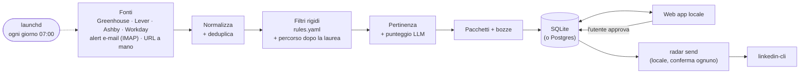

# Radar

[](https://github.com/DanieleGiovanardi2408/speculor/actions/workflows/ci.yml)
[](LICENSE)
[](https://www.python.org/)

**Radar è un agente per la ricerca di stage che ogni mattina, sul tuo Mac, trova, filtra, ordina
e prepara le candidature, e poi aspetta te.**

[English](README.md)

## Human in the loop

**Niente viene mai candidato o inviato in automatico.** Radar raccoglie annunci pubblici, scarta
quelli non adatti, ordina gli altri con un LLM e prepara pacchetti di candidatura e bozze di
messaggi. L'utente li legge, li modifica e li approva nella web app locale. Le candidature le
invia sempre l'utente; i messaggi LinkedIn approvati partono solo dal Mac dell'utente con
`radar send`, uno alla volta, ciascuno dopo una conferma esplicita.

## Screenshot

| Oggi | Annunci | Pacchetto |
|---|---|---|
|  |  |  |
| **Approvazioni** | **Dopo la laurea** | **Esecuzioni** |
|  |  |  |

Tutti gli screenshot usano i dati demo inventati (`make dev`).

## Come funziona



- **Fonti**: API pubbliche degli ATS (Greenhouse, Lever, Ashby, Workday) per una lista di
  aziende scelta dall'utente, alert e-mail di LinkedIn e JobTeaser via IMAP in sola lettura
  (opzionale), URL aggiunti a mano. Dettagli in [docs/SOURCES.md](docs/SOURCES.md).
- **Filtri**: regole deterministiche in `config/rules.yaml` (finestra di inizio, anno di laurea,
  solo PhD, anni di esperienza, sede, visto, lingue richieste, convenzione di tirocinio). I
  graduate programme e i ruoli full-time che iniziano dopo la laurea finiscono nella vista
  *Dopo la laurea*. Ogni scarto salva regola e testo; si ripristina con un clic (con annulla).
- **Punteggio**: un LLM assegna Alta / Media / Bassa con le motivazioni. I titoli fuori target
  (tax, payroll, sales, legal, HR, ...) prendono "Bassa" senza chiamare l'LLM; cache per hash del
  contenuto; dopo il limite giornaliero gratuito si riprende il giorno dopo.
- **Pacchetti**: lettera (massimo 250 parole, prima riga "Disponibile full-time da febbraio 2027,
  con inizio flessibile fino ad aprile 2027."), risposte ai form e bozze di messaggi, con regole
  di scrittura verificate nel codice.

Dettagli in [docs/ARCHITECTURE.md](docs/ARCHITECTURE.md).

## Avvio rapido (demo, senza chiavi)

```bash
git clone https://github.com/DanieleGiovanardi2408/speculor.git
cd speculor
make install
make dev    # poi apri http://localhost:5173
```

`make dev` usa dati demo inventati e un LLM finto offline: nessuna chiave API necessaria.

## Uso reale

```bash
for f in config/*.example.yaml; do cp "$f" "${f/.example/}"; done   # poi modificali
cp .env.example .env    # poi imposta GROQ_API_KEY
make seed               # opzionale: importa un tracker esistente
make run-pipeline       # prima esecuzione, a mano
make dev-real           # revisione nella web app su data/radar.db
make schedule-install   # da qui in poi ogni mattina alle 07:00
```

## Configurazione

- `config/*.example.yaml` -> `config/*.yaml` (profilo, aziende, regole) e `.env.example` ->
  `.env`: tutti ignorati da git. Ogni variabile è documentata in `.env.example`.
- **LLM**: Groq (piano gratuito) di default, `openai/gpt-oss-20b` per il punteggio e
  `openai/gpt-oss-120b` per le bozze. Per passare ad Anthropic per le bozze:
  `RADAR_DRAFT_PROVIDER=anthropic`, `RADAR_DRAFT_MODEL=claude-sonnet-5-5`, `ANTHROPIC_API_KEY`.
  Il provider `fake` funziona offline.
- Le fonti si attivano o disattivano in *Impostazioni*.

## Esecuzione giornaliera (launchd)

Tutto gira in locale sul Mac dell'utente, con un job launchd alle 07:00:

| Comando | Cosa fa |
|---|---|
| `make schedule-install` | Installa il job giornaliero |
| `make schedule-status` | Stato, ultimo exit code e ultime righe del log |
| `make schedule-run-now` | Lo esegue subito |
| `make schedule-remove` | Lo rimuove |
| `make run-pipeline` / `make report` | Esecuzione a mano / ultimo report |
| `make send` / `make send-dry` | Invia le bozze LinkedIn approvate, una alla volta, con conferma (o in prova) |

Se il Mac dorme alle 07:00, launchd recupera l'esecuzione al risveglio (non se era spento). Una
sola esecuzione alla volta; log in `logs/daily.log` (solo conteggi), ruotato a circa 2 MB.
Dettagli in [docs/RUNNING.md](docs/RUNNING.md).

## Limiti ed etica

- **Raccolta educata**: user agent onesto, rate limit per host (almeno 1 s, 2 s per Workday),
  cache su disco, back-off che rispetta `Retry-After`.
- **robots.txt rispettato anche quando costa risultati**: LinkedIn vieta `/jobs-guest/` ai
  crawler non autorizzati, quindi il connettore LinkedIn lo segnala e non scarica nulla;
  l'API di SmartRecruiters vieta gli agenti generici, quindi quel connettore è disattivato.
- **Nessuno scraping con login**, nessuna elusione di CAPTCHA o anti-bot, nessun cookie tranne la
  sessione linkedin-cli dell'utente sul suo Mac. I Termini di LinkedIn limitano l'accesso
  automatico: Radar non fa scraping di LinkedIn; l'invio con linkedin-cli è locale, confermato
  messaggio per messaggio e sotto la responsabilità dell'utente.
- **IMAP**: legge solo una cartella/etichetta (`radar`, impostata con `RADAR_IMAP_FOLDER`) di una
  casella Gmail o Outlook.com, in sola lettura (`EXAMINE`, `BODY.PEEK`): niente viene segnato come
  letto, spostato, cancellato o contrassegnato (il client IMAP rifiuta quei comandi). Solo gli
  alert di LinkedIn e JobTeaser vengono scaricati e letti; il resto è ignorato e non arriva mai
  all'LLM. Il contenuto delle e-mail non finisce mai nei log; le credenziali (password per app
  Gmail o token OAuth2 Outlook da `radar imap login`) stanno nel portachiavi macOS o nel `.env`
  locale. Configurazione: [docs/RUNNING.md](docs/RUNNING.md#email-alerts-imap).
- **LLM**: il testo degli annunci e il profilo dell'utente vanno al provider LLM configurato.
- **GitHub** ospita solo il codice ed esegue la CI, senza segreti e senza dati reali.

## Postgres in self-hosting (opzionale)

SQLite è il default. Postgres è supportato ma opzionale e non testato in produzione: vedi
[docs/RUNNING.md](docs/RUNNING.md#self-hosting-on-postgres-optional).

## Licenza

[MIT](LICENSE) © 2026 Daniele Giovanardi
