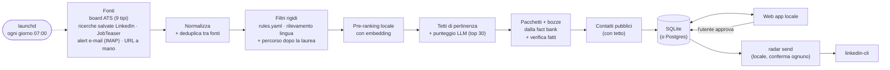

# Radar

[](https://github.com/DanieleGiovanardi2408/speculor/actions/workflows/ci.yml)
[](LICENSE)
[](https://www.python.org/)

**Radar è un agente per la ricerca di stage che ogni mattina, sul tuo Mac, trova, filtra, ordina
e prepara le candidature, e poi aspetta te.**

[English](README.md)

## Human in the loop

**Niente viene mai candidato o inviato in automatico.** Radar raccoglie annunci pubblici, scarta
quelli non adatti, ordina gli altri con un LLM e prepara pacchetti di candidatura e bozze di
messaggi. L'utente li legge, li modifica e li approva nella web app locale. Le candidature le
invia sempre l'utente; i messaggi LinkedIn approvati partono solo dal Mac dell'utente con
`radar send`, uno alla volta, ciascuno dopo una conferma esplicita.

## Screenshot

| Oggi | Annunci | Pacchetto |
|---|---|---|
|  |  |  |
| **Approvazioni** | **Dopo la laurea** | **Esecuzioni** |
|  |  |  |

Tutti gli screenshot usano i dati demo inventati (`make dev`).

## Come funziona



- **Fonti**: API e feed pubblici degli ATS (Greenhouse, Lever, Ashby, Workday, Personio,
  Workable, Teamtailor, Recruitee, inRecruiting) per una lista di aziende scelta dall'utente,
  divisa per settore; facoltativi: le ricerche salvate LinkedIn dell'utente (con linkedin-cli),
  il Career Service JobTeaser (profilo browser locale), gli alert e-mail di LinkedIn e JobTeaser
  via IMAP in sola lettura; e gli URL aggiunti a mano. Lo stesso annuncio visto su più fonti è
  un solo annuncio con tutte le fonti elencate. Dettagli in [docs/SOURCES.md](docs/SOURCES.md).
- **Filtri**: regole deterministiche in `config/rules.yaml` (finestra di inizio, anno di laurea,
  solo PhD, anni di esperienza, sede, visto, lingue richieste, convenzione di tirocinio). I
  graduate programme e i ruoli full-time che iniziano dopo la laurea finiscono nella vista
  *Dopo la laurea*. Ogni scarto salva regola e testo; si ripristina con un clic (con annulla).
  Il rilevamento locale della lingua segnala *lingua probabilmente richiesta* quando la
  descrizione è soprattutto in francese, tedesco, spagnolo o olandese.
- **Pre-ranking locale** (facoltativo, gratuito): con l'extra `embed` un piccolo modello di
  embedding multilingue sul Mac calcola l'*Affinità* di ogni annuncio con la fact bank e i ruoli
  target; il budget LLM (30 al giorno di default) va prima agli annunci più vicini.
- **Punteggio**: un LLM assegna Alta / Media / Bassa con le motivazioni. I titoli fuori target
  (tax, payroll, sales, legal, HR, ...) prendono "Bassa" senza chiamare l'LLM; ogni flag dei
  filtri arriva all'LLM come fatto; una lingua richiesta che l'utente non parla non è mai Alta,
  e i ruoli generici di software, QA e vendite sono al massimo Media; cache per hash del
  contenuto; dopo il limite giornaliero gratuito si riprende il giorno dopo.
- **Pacchetti**: lettera (massimo 250 parole, prima riga "Disponibile full-time da febbraio 2027,
  con inizio flessibile fino ad aprile 2027."), risposte ai form e bozze di messaggi, con regole
  di scrittura verificate nel codice. Ogni fatto viene dalla fact bank (`config/facts.yaml`):
  il resto diventa `[CHECK: ...]` e la *Verifica fatti* segnala le affermazioni non supportate.

Dettagli in [docs/ARCHITECTURE.md](docs/ARCHITECTURE.md).

## Avvio rapido (demo, senza chiavi)

```bash
git clone https://github.com/DanieleGiovanardi2408/speculor.git
cd speculor
make install
make dev    # poi apri http://localhost:5173
```

`make dev` usa dati demo inventati e un LLM finto offline: nessuna chiave API necessaria.

## Uso reale

```bash
for f in config/*.example.yaml; do cp "$f" "${f/.example/}"; done   # poi modificali
cp .env.example .env    # poi imposta GROQ_API_KEY
make seed               # opzionale: importa un tracker esistente
make run-pipeline       # prima esecuzione, a mano
make dev-real           # revisione nella web app su data/radar.db
make schedule-install   # da qui in poi ogni mattina alle 07:00
```

## Configurazione

- `config/*.example.yaml` -> `config/*.yaml` (profilo, aziende, regole) e `.env.example` ->
  `.env`: tutti ignorati da git. Ogni variabile è documentata in `.env.example`.
- **LLM**: Groq (piano gratuito) di default, `openai/gpt-oss-20b` per il punteggio e
  `openai/gpt-oss-120b` per le bozze. Per passare ad Anthropic per le bozze:
  `RADAR_DRAFT_PROVIDER=anthropic`, `RADAR_DRAFT_MODEL=claude-sonnet-5-5`, `ANTHROPIC_API_KEY`.
  Il provider `fake` funziona offline.
- Le fonti si attivano o disattivano in *Impostazioni*.

## Esecuzione giornaliera (launchd)

Tutto gira in locale sul Mac dell'utente, con un job launchd alle 07:00:

| Comando | Cosa fa |
|---|---|
| `make schedule-install` | Installa il job giornaliero |
| `make schedule-status` | Stato, ultimo exit code e ultime righe del log |
| `make schedule-run-now` | Lo esegue subito |
| `make schedule-remove` | Lo rimuove |
| `make run-pipeline` / `make report` | Esecuzione a mano / ultimo report |
| `make send` / `make send-dry` | Invia le bozze LinkedIn approvate, una alla volta, con conferma (o in prova) |

Se il Mac dorme alle 07:00, launchd recupera l'esecuzione al risveglio (non se era spento). Una
sola esecuzione alla volta; log in `logs/daily.log` (solo conteggi), ruotato a circa 2 MB.
Dettagli in [docs/RUNNING.md](docs/RUNNING.md).

## Limiti ed etica

Radar è uno strumento personale. Tutto gira sul Mac dell'utente, dal job launchd, una richiesta
alla volta; niente gira nel cloud e la CI non tocca mai dati reali, sessioni o chiavi.

**Cosa viene letto, e con che ritmo**

| Fonte | Cosa | Ritmo |
|---|---|---|
| Board ATS (Greenhouse, Lever, Ashby, Workday, Personio, Workable, Teamtailor, Recruitee, inRecruiting) | API e feed pubblici delle aziende scelte dall'utente | una volta al giorno, almeno 1 s per host (2 s su Workday), cache HTTP di 12 h |
| Ricerche salvate LinkedIn (facoltative) | Le ricerche di lavoro dell'utente, tramite linkedin-cli e la sua sessione | una volta al giorno, in sequenza, al massimo 25 chiamate (linkedin-cli limita le chiamate jobs a 30 al giorno) |
| JobTeaser (facoltativo) | Le offerte del Career Service Luiss: le liste solo quando l'utente preme "Salva in Radar" (estensione del browser) su una pagina aperta da lui; poi le singole offerte per la descrizione, da un profilo browser locale in cui l'utente accede a mano | al clic; pagine delle offerte una volta al giorno, una alla volta, 5 s fissi tra le pagine, al massimo 40 offerte |
| Alert e-mail (facoltativi) | Gli alert di LinkedIn e JobTeaser in una cartella/etichetta `radar` | una volta al giorno, in sola lettura |
| Contatti (facoltativi) | Risultati di ricerca pubblici per 2-3 persone per annuncio Alta (ricerca web di Groq) | al massimo 5 annunci e 10 chiamate al giorno, tetto rigido di 5 euro al mese |

**Regole imposte nel codice**

- **Niente viene mai inviato o candidato in automatico.** Le candidature le invia sempre
  l'utente; i messaggi LinkedIn partono solo con `radar send`, uno alla volta, dopo una `s`
  esplicita.
- **robots.txt rispettato anche quando costa risultati** (regole con wildcard comprese). Le
  pagine guest di LinkedIn, l'API di SmartRecruiters, molti feed Personio e le liste di offerte
  di JobTeaser sono vietati, quindi Radar non li legge. Per JobTeaser è l'utente ad aprire le
  liste nel proprio browser e a premere "Salva in Radar": l'estensione invia solo le offerte già
  mostrate in quella pagina, senza scorrere, senza paginare e senza trucchi sui tempi; Radar poi
  apre solo le singole pagine delle offerte, che robots.txt consente. Dettagli in
  [docs/SOURCES.md](docs/SOURCES.md).
- **Nessuna risoluzione di CAPTCHA, nessuna elusione anti-bot**: niente proxy, niente trucchi
  sul fingerprint, niente parallelismo, user agent onesto. Un checkpoint, un captcha, un HTTP
  429/999 o una sessione scaduta **mettono in pausa** subito quella fonte, senza ritentare;
  *Oggi* mostra la pausa e cosa fare, e la fonte resta ferma finché l'utente non la riprende.
  Una fonte che fallisce non ferma mai le altre.
- **Le sessioni restano locali**: la sessione linkedin-cli e il profilo browser di JobTeaser
  stanno solo sul Mac dell'utente; i cookie non vengono mai letti, esportati o scritti nei log.
- **E-mail**: una sola cartella/etichetta, aperta con `EXAMINE` e letta con `BODY.PEEK` (il
  client rifiuta qualsiasi comando che segni, sposti o cancelli). Vengono scaricati solo gli
  alert di LinkedIn e JobTeaser; ogni altro messaggio è ignorato, mai scritto nei log e mai
  inviato all'LLM. Le credenziali (password per app Gmail o token OAuth2 Outlook) stanno nel
  portachiavi macOS o nel `.env` locale.
- **Fatti, non abbellimenti**: le bozze possono dichiarare solo fatti della fact bank
  dell'utente (`config/facts.yaml`); tutto il resto diventa `[CHECK: ...]`, e una seconda
  chiamata LLM più un controllo deterministico segnalano in *Pacchetto* ogni affermazione non
  supportata.
- **Contatti**: solo risultati di ricerca pubblici, mai un login su LinkedIn. Un contatto resta
  solo se il suo URL compare nei risultati, e Radar salva solo nome, ruolo, URL pubblico e una
  riga di motivazione, segnato *da verificare*.
- **Dati all'LLM**: il testo degli annunci e i fatti pertinenti vanno al provider LLM configurato
  (Groq di default). Il provider `fake` tiene tutto offline; gli embedding sono calcolati in
  locale.
- **Log**: solo conteggi, mai nomi, titoli, contenuti e-mail o chiavi.
- I Termini di LinkedIn limitano l'accesso automatico; le funzioni LinkedIn facoltative usano la
  sessione dell'utente a ritmo umano e sono sotto la sua responsabilità.

## Postgres in self-hosting (opzionale)

SQLite è il default. Postgres è supportato ma opzionale e non testato in produzione: vedi
[docs/RUNNING.md](docs/RUNNING.md#self-hosting-on-postgres-optional).

## Licenza

[MIT](LICENSE) © 2026 Daniele Giovanardi
