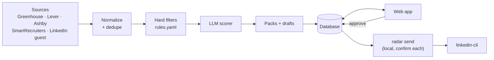

# Radar

[](https://github.com/DanieleGiovanardi2408/speculor/actions/workflows/ci.yml)
[](LICENSE)
[](https://www.python.org/)

**Radar is an internship-hunting agent that finds, filters, ranks and prepares applications every
morning, and then waits for you.**

[Italiano](README.it.md)

## Human in the loop

Nothing is sent or submitted automatically. Radar collects public postings, discards what does
not fit, ranks the rest with an LLM and prepares application packs and outreach drafts. The user
reads, edits and approves them in a web app. Applications are always submitted by the user;
approved LinkedIn messages are sent only from the user's own computer with `radar send`, one by
one, each after an explicit confirmation.

## Screenshots

| Oggi (today) | Annunci (postings) |
|---|---|
|  |  |
| **Pacchetto (application pack)** | **Approvazioni (approvals)** |
|  |  |

Screenshots use the fictional demo data (`make dev`).

## How it works



A daily diff (`change_events`) tracks new, changed, closed and reopened postings; every run is
recorded with counts and a Markdown report. Details: [docs/ARCHITECTURE.md](docs/ARCHITECTURE.md).

## Quickstart

Requires Python 3.12 + [uv](https://docs.astral.sh/uv/), Node 20 + pnpm.

```bash
git clone https://github.com/DanieleGiovanardi2408/speculor.git
cd speculor
make install
make dev
# open http://localhost:5173
```

`make dev` runs a demo with fictional data and an offline fake LLM: no API keys, no network
calls for scoring. `make help` lists all commands.

## Configuration

- `config/profile.example.yaml`, `config/companies.example.yaml`, `config/rules.example.yaml`:
  copy each to `config/<name>.yaml` and edit (profile and preferences, target companies with
  their ATS, deterministic filter rules). The real files are gitignored.
- `.env.example`: copy to `.env` (gitignored). Every variable is documented there: database
  URL, LLM provider and models, API keys, user agent, cache TTL, linkedin-cli path, CORS, auth.
- Sources can be enabled or disabled in the web app (*Impostazioni*).

## Daily pipeline

```bash
make run-pipeline   # = uv run radar run
make report         # print the latest report
```

`radar run` collects, dedupes, checks closed postings, applies the filters, computes the diff,
scores new postings, builds packs for the best ones and writes a report. In the cloud, the same
command runs every day at 07:00 Europe/Amsterdam on GitHub Actions; its data lives on an orphan
`data` branch, never on `main` (see [docs/DEPLOYMENT.md](docs/DEPLOYMENT.md)).

## Sending approved drafts: `radar send`

```bash
make send       # = uv run radar send
make send-dry   # linkedin-cli --dry-run, statuses unchanged
```

For each approved LinkedIn draft (oldest first) Radar shows the company, role, contact,
recipient, kind, length and full text, then asks
`Inviare? [s]ì / [n]o / [k] skip definitivo / [e] modifica / [q] esci`. The default is **no**;
only an explicit `s` sends. Sending goes through the user's own
linkedin-cli (mayai-linkedin-cli) as a subprocess, so its throttle and
daily quotas apply; a quota error stops the loop. linkedin-cli v0.2 cannot attach a note to a
connection request: Radar says so, shows the note, and offers `[c]` to copy it and open the
profile instead. `radar send` refuses to run in CI.

## Deployment

Local first. Daily runs on GitHub Actions (secrets: `GROQ_API_KEY`, optional
`ANTHROPIC_API_KEY`). Supabase (Postgres + email auth with an allow-list) and Vercel (FastAPI +
static frontend) are planned. See [docs/DEPLOYMENT.md](docs/DEPLOYMENT.md).

## Limits and ethics

Radar is a personal tool that reads a small amount of public data, politely:

- **Sources**: public ATS job APIs and pages (Greenhouse, Lever, Ashby, SmartRecruiters) for a
  user-curated list of companies, and LinkedIn's public guest job search.
- **Politeness**: per-host rate limits, an on-disk HTTP cache (default 12 h), an honest user
  agent with a link to this repository, robots.txt checks for HTML pages, exponential back-off
  honouring `Retry-After` on 429/403/5xx, and a hard stop after repeated failures.
- **No logged-in scraping**, no cookies in the cloud or CI, no CAPTCHA solving, no proxy
  rotation or fingerprint evasion. When a source blocks us, the run records the failure and
  moves on.
- **LinkedIn**: the guest job search is public, but LinkedIn's User Agreement restricts
  automated access. Radar uses it at low volume, it is optional and can be disabled in
  *Impostazioni*, and the project accepts failures rather than evading blocks.
- **Sending** through linkedin-cli uses the user's own LinkedIn session, runs only locally and
  only after explicit confirmation of each message; it is the user's own responsibility.
- **LLM**: posting text and the user's profile are sent to the configured LLM provider (Groq by
  default) for scoring and drafting. Use the `fake` provider to keep everything offline.

## Contributing

See [CONTRIBUTING.md](CONTRIBUTING.md). Personal data is never committed; pre-commit hooks
(gitleaks and a personal-data guard) enforce it.

## License

[MIT](LICENSE) © 2026 Daniele Giovanardi
