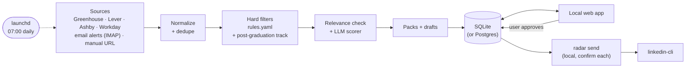

# Radar

[](https://github.com/DanieleGiovanardi2408/speculor/actions/workflows/ci.yml)
[](LICENSE)
[](https://www.python.org/)

**Radar is an internship-hunting agent that runs on your own Mac every morning: it finds,
filters, ranks and prepares applications, and then waits for you.**

[Italiano](README.it.md)

## Human in the loop

**Nothing is ever submitted or sent automatically.** Radar collects public postings, discards
what does not fit, ranks the rest with an LLM and prepares application packs and outreach
drafts. The user reads, edits and approves them in a local web app. Applications are always
submitted by the user; approved LinkedIn messages are sent only from the user's own Mac with
`radar send`, one by one, each after an explicit confirmation.

## Screenshots

| Oggi (today) | Annunci (postings) | Pacchetto (application pack) |
|---|---|---|
|  |  |  |
| **Approvazioni (approvals)** | **Dopo la laurea (post-graduation track)** | **Esecuzioni (run report)** |
|  |  |  |


All screenshots use the fictional demo data (`make dev`). Every page also works at phone width
(right: *Oggi* at 390 px). More in [docs/screenshots/](docs/screenshots/).

<br clear="right">

## How it works



- **Sources**: public ATS job APIs (Greenhouse, Lever, Ashby, Workday) for a user-curated list
  of companies, optional LinkedIn and JobTeaser alert emails over read-only IMAP, and URLs added
  by hand. Details per connector in [docs/SOURCES.md](docs/SOURCES.md).
- **Filters**: deterministic rules in `config/rules.yaml` (start window, graduation year,
  PhD-only, years of experience, location, visa, required languages, enrollment-agreement
  flags). Graduate programmes and full-time roles that start after graduation are not dropped:
  they go to a separate *Dopo la laurea* (post-graduation) view. Every hit stores the rule and the
  text that triggered it, and any posting can be restored with one click (with undo).
- **Scoring**: an LLM rates each remaining posting Alta / Media / Bassa and explains why.
  Clearly off-target titles (tax, payroll, sales, legal, HR, ...) get "Bassa" without an LLM
  call, target roles are scored first, scores are cached by content hash, and a run that hits
  the free-tier daily limit resumes the next day.
- **Packs**: cover letter (at most 250 words, opening with the availability line), form answers
  and outreach drafts. Writing rules are enforced in code (no em dashes, no cliches, length
  limits, `[CHECK: ...]` markers for anything the user must verify).
- **Daily diff**: `change_events` tracks new, changed, closed and reopened postings; every run is
  recorded with counts, LLM usage and a Markdown report.

Details: [docs/ARCHITECTURE.md](docs/ARCHITECTURE.md).

## Quickstart (demo, no keys)

Requires Python 3.12 + [uv](https://docs.astral.sh/uv/), Node 20 + pnpm.

```bash
git clone https://github.com/DanieleGiovanardi2408/speculor.git
cd speculor
make install
make dev    # then open http://localhost:5173
```

`make dev` runs a demo with fictional data and an offline fake LLM: no API keys, no network
calls for scoring. `make help` lists all commands.

## Real use

```bash
for f in config/*.example.yaml; do cp "$f" "${f/.example/}"; done   # then edit them
cp .env.example .env    # then set GROQ_API_KEY
make seed               # optional: import an existing tracker export
make run-pipeline       # first run, by hand
make dev-real           # review in the web app on data/radar.db
make schedule-install   # from now on, every morning at 07:00
```

## Configuration

- `config/profile.example.yaml`, `config/companies.example.yaml`, `config/rules.example.yaml`:
  copy each to `config/<name>.yaml` and edit (profile and preferences, target companies with
  their ATS, deterministic filter rules). The real files are gitignored.
- `.env.example`: copy to `.env` (gitignored). Every variable is documented there: database URL,
  LLM providers and models, API keys, user agent, cache TTL, IMAP mailbox, linkedin-cli path.
- **LLM**: Groq free tier by default (`openai/gpt-oss-20b` for scoring, `openai/gpt-oss-120b`
  for packs and drafts). Switching drafts to Anthropic is one line:
  `RADAR_DRAFT_PROVIDER=anthropic` with `RADAR_DRAFT_MODEL=claude-sonnet-5-5` and
  `ANTHROPIC_API_KEY`. The `fake` provider works fully offline.
- Sources can be enabled or disabled in the web app (*Impostazioni*).

## Daily run (launchd)

Everything runs locally on the user's Mac. A macOS launchd job runs `radar run` every day at
07:00:

```bash
make schedule-install   # install the launchd job
make schedule-status    # installed? last exit code and last log lines
make schedule-run-now   # run it right now
make schedule-remove    # uninstall
```

If the Mac is asleep at 07:00, launchd runs the missed job when it wakes (not if it was shut
down). Only one run happens at a time (a lock), and output goes to `logs/daily.log` (counts
only, never names or titles), rotated at about 2 MB. `make run-pipeline` runs the same pipeline
by hand and `make report` prints the latest report. More in [docs/RUNNING.md](docs/RUNNING.md).

## The web app

Local only (`make dev-real`), in Italian:

| Page | What it is for |
|---|---|
| *Oggi* | Today's action list: deadlines in the next 7 days, new Alta postings, packs to review, follow-ups, drafts, weekly goal; last run card with LLM usage |
| *Annunci* | Postings in three tabs: *Stage* \| *Dopo la laurea* \| *Scartati*. Keyboard: `j`/`k` move, `Enter` open details, `p` pack, `s` mark as sent, `x` skip with a reason, `r` restore, `/` search, `?` help (plus `g o` / `g a` / `g p` to jump between pages) |
| *Pacchetto* | Application pack: cover letter, form answers, contacts and drafts, all editable |
| *Approvazioni* | Approve or skip outreach drafts |
| *Candidature* | Applications tracker with stages and follow-ups |
| *Aziende* | Target companies and their boards |
| *Impostazioni* | Sources on/off, weekly goal |
| *Esecuzioni* | Run history and the full run report |

The UI is checked with axe (WCAG 2.1 AA, no violations) at 1280 px and 390 px.

## Sending approved drafts: `radar send`

```bash
make send       # = uv run radar send
make send-dry   # linkedin-cli --dry-run, statuses unchanged
```

For each approved LinkedIn draft (oldest first) Radar shows the company, role, contact,
recipient, kind, length and full text, then asks
`Inviare? [s]ì / [n]o / [k] skip definitivo / [e] modifica / [q] esci`. The default is **no**;
only an explicit `s` sends. Sending goes through the user's own linkedin-cli
(mayai-linkedin-cli) as a subprocess, so its throttle and daily quotas apply; a quota error stops
the loop. linkedin-cli v0.2 cannot attach a note to a connection request: Radar says so, shows
the note, and offers `[c]` to copy it and open the profile instead. `radar send` refuses to run
in CI.

## Limits and ethics

Radar is a personal tool that reads a small amount of public data, politely:

- **Polite collection**: an honest user agent with a link to this repository, per-host rate
  limits (at least 1 s, 2 s for Workday hosts), an on-disk HTTP cache (default 12 h), exponential
  back-off honouring `Retry-After` on 429/403/5xx, and a hard stop after repeated failures.
- **robots.txt is respected, even when it costs results.** LinkedIn's robots.txt disallows
  `/jobs-guest/` for every crawler that is not explicitly whitelisted, so the LinkedIn guest
  connector checks it, reports "disallowed by robots.txt" and fetches nothing. The
  SmartRecruiters posting API's robots.txt disallows generic agents, so that connector is kept
  but disabled. Workday boards are called only if robots.txt allows `/wday/cxs/`. Details in
  [docs/SOURCES.md](docs/SOURCES.md).
- **No logged-in scraping**, no CAPTCHA solving, no proxy rotation or fingerprint evasion. No
  cookies anywhere, except the user's own linkedin-cli session on the user's Mac. When a source
  blocks Radar, the run records the failure and moves on.
- **LinkedIn**: LinkedIn's User Agreement restricts automated access. Radar does not scrape
  LinkedIn; LinkedIn postings arrive through LinkedIn's own alert emails or *Aggiungi da URL*.
  Sending through linkedin-cli uses the user's own session, runs only locally and only after an
  explicit confirmation of each message; it is the user's own responsibility.
- **Email alerts (IMAP)**: optional. Radar reads only one Gmail label (`radar`, set with `RADAR_IMAP_FOLDER`), opens
  it read-only (`EXAMINE`) and fetches with `BODY.PEEK`, so nothing is marked as read, moved,
  deleted or flagged. Only LinkedIn and JobTeaser alert senders are parsed; every other message
  is ignored and never sent to the LLM. Email content is never logged, and the credentials (a
  Gmail app password) live only in the local `.env`.
- **LLM data**: posting text and the user's profile are sent to the configured LLM provider (Groq
  by default) for scoring and drafting. From email, only the content of alert-sender messages is
  used. Use the `fake` provider to keep everything offline.
- **GitHub** only hosts the code and runs CI (ruff, mypy, pytest, frontend lint, typecheck, tests
  and build, gitleaks) with no secrets and no real data.

## Self-hosting on Postgres (optional)

SQLite (`data/radar.db`) is the default and the supported setup. Postgres also works, for anyone
who wants the database elsewhere; this path is optional and **not tested in production**. See
[docs/RUNNING.md](docs/RUNNING.md#self-hosting-on-postgres-optional) for the commands
(`radar db copy`, `radar db secure`) and the optional Supabase JWT auth for the API.

## Contributing

See [CONTRIBUTING.md](CONTRIBUTING.md). Personal data is never committed; pre-commit hooks
(gitleaks and a personal-data guard) enforce it.

## License

[MIT](LICENSE) © 2026 Daniele Giovanardi
