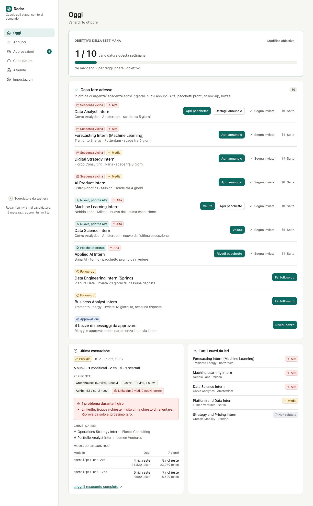
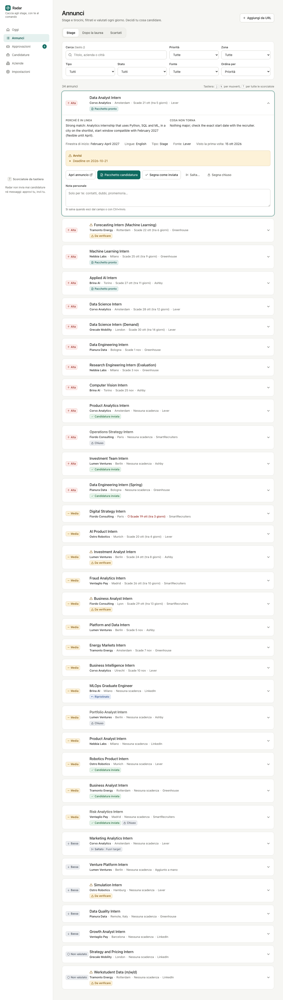
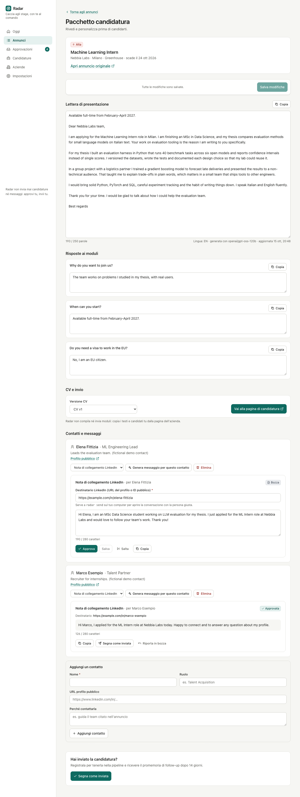
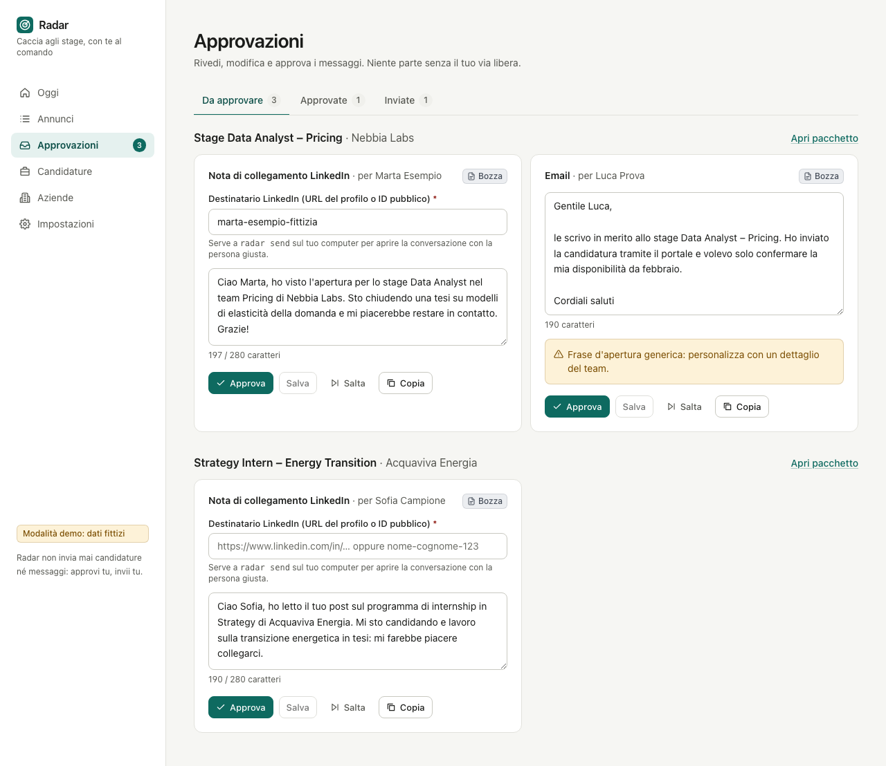
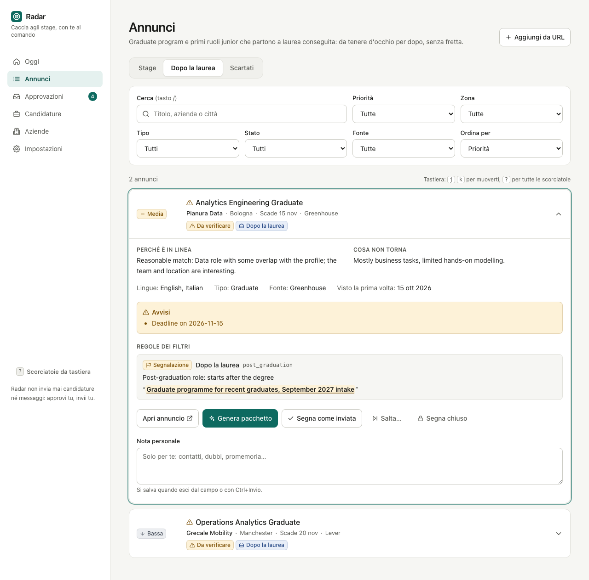
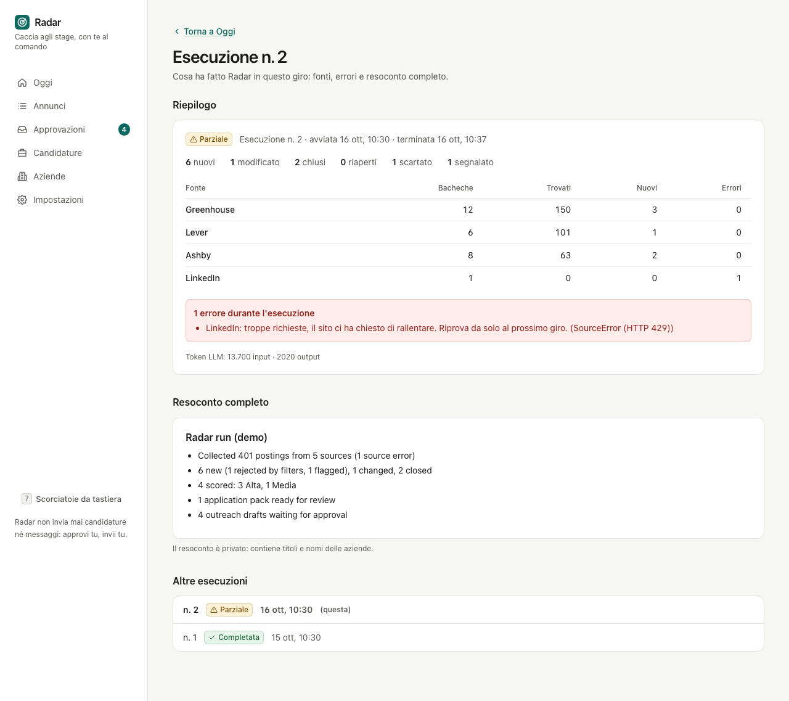
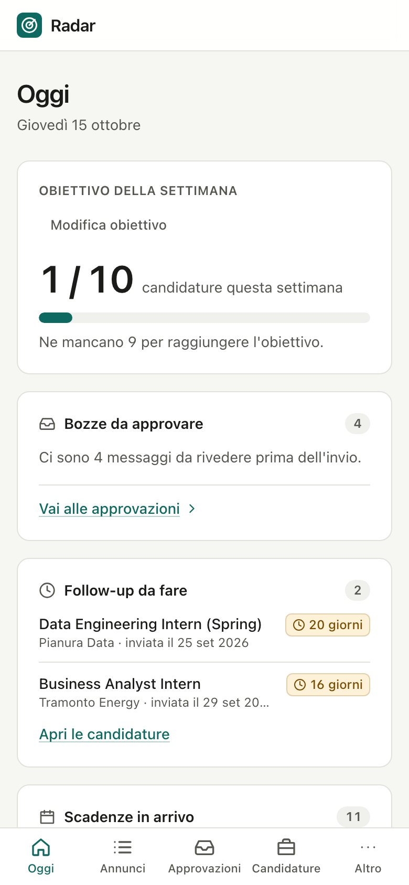
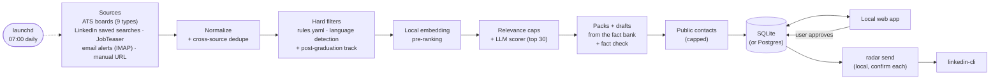

# Radar

[](https://github.com/DanieleGiovanardi2408/speculor/actions/workflows/ci.yml)
[](LICENSE)
[](https://www.python.org/)

**Radar is an internship-hunting agent that runs on your own Mac every morning: it finds,
filters, ranks and prepares applications, and then waits for you.**

[Italiano](README.it.md)

## Human in the loop

**Nothing is ever submitted or sent automatically.** Radar collects public postings, discards
what does not fit, ranks the rest with an LLM and prepares application packs and outreach
drafts. The user reads, edits and approves them in a local web app. Applications are always
submitted by the user; approved LinkedIn messages are sent only from the user's own Mac with
`radar send`, one by one, each after an explicit confirmation.

## Screenshots

| Oggi (today) | Annunci (postings) | Pacchetto (application pack) |
|---|---|---|
|  |  |  |
| **Approvazioni (approvals)** | **Dopo la laurea (post-graduation track)** | **Esecuzioni (run report)** |
|  |  |  |



All screenshots use the fictional demo data (`make dev`). Every page also works at phone width
(right: *Oggi* at 390 px). More in [docs/screenshots/](docs/screenshots/).

<br clear="right">

## How it works



- **Sources**: public ATS job APIs and feeds (Greenhouse, Lever, Ashby, Workday, Personio,
  Workable, Teamtailor, Recruitee, inRecruiting) for a user-curated list of companies, tagged by
  sector; optionally the user's own LinkedIn saved searches (through linkedin-cli), the JobTeaser
  career service (a local browser profile), LinkedIn and JobTeaser alert emails over read-only
  IMAP; and URLs added by hand. The same job from several sources is one posting with all its
  sources listed. Details per connector in [docs/SOURCES.md](docs/SOURCES.md).
- **Filters**: deterministic rules in `config/rules.yaml` (start window, graduation year,
  PhD-only, years of experience, location, visa, required languages, enrollment-agreement
  flags), plus local language detection: a description mostly in French, German, Spanish or
  Dutch is flagged *lingua probabilmente richiesta*. Graduate programmes and full-time roles that start after graduation are not dropped:
  they go to a separate *Dopo la laurea* (post-graduation) view. Every hit stores the rule and the
  text that triggered it, and any posting can be restored with one click (with undo).
- **Scoring**: an LLM rates each remaining posting Alta / Media / Bassa and explains why. Every
  filter flag is passed to it as a fact, and deterministic caps apply afterwards: a required
  language the user does not speak is never Alta, and generic software, QA and sales roles are
  Media at most.
  Clearly off-target titles (tax, payroll, sales, legal, HR, ...) get "Bassa" without an LLM
  call, target roles are scored first, scores are cached by content hash, and a run that hits
  the free-tier daily limit resumes the next day.
- **Local pre-ranking** (optional, free): with the `embed` extra (`uv sync --extra embed`), a
  small multilingual embedding model on the Mac computes each posting's similarity to the fact
  bank and target roles; the LLM budget (`--max-score`, default 30) goes to the closest postings
  first and the web app shows and sorts by *Affinità*. `radar rank` refreshes it on its own.
- **Packs**: cover letter (at most 250 words, opening with the availability line), form answers
  and outreach drafts. Writing rules are enforced in code (no em dashes, no cliches, length
  limits, `[CHECK: ...]` markers for anything the user must verify).
- **Daily diff**: `change_events` tracks new, changed, closed and reopened postings; every run is
  recorded with counts, LLM usage and a Markdown report.

Details: [docs/ARCHITECTURE.md](docs/ARCHITECTURE.md).

## Quickstart (demo, no keys)

Requires Python 3.12 + [uv](https://docs.astral.sh/uv/), Node 20 + pnpm.

```bash
git clone https://github.com/DanieleGiovanardi2408/speculor.git
cd speculor
make install
make dev    # then open http://localhost:5173
```

`make dev` runs a demo with fictional data and an offline fake LLM: no API keys, no network
calls for scoring. `make help` lists all commands.

## Real use

```bash
for f in config/*.example.yaml; do cp "$f" "${f/.example/}"; done   # then edit them
cp .env.example .env    # then set GROQ_API_KEY
make seed               # optional: import an existing tracker export
make run-pipeline       # first run, by hand
make dev-real           # review in the web app on data/radar.db
make schedule-install   # from now on, every morning at 07:00
```

## Configuration

- `config/profile.example.yaml`, `config/companies.example.yaml`, `config/rules.example.yaml`:
  copy each to `config/<name>.yaml` and edit (profile and preferences, target companies with
  their ATS, deterministic filter rules). The real files are gitignored.
- `config/facts.example.yaml`: copy to `config/facts.yaml` (gitignored). The fact bank is the
  **only** source of facts for every draft: anything else becomes a `[CHECK: ...]` marker, and a
  second LLM call checks every claim against it (*Verifica fatti* in *Pacchetto*). The profile
  is used only for scoring. Validate it with `uv run radar facts check`.
- `.env.example`: copy to `.env` (gitignored). Every variable is documented there: database URL,
  LLM providers and models, API keys, user agent, cache TTL, IMAP mailbox, linkedin-cli path.
- **LLM**: Groq free tier by default (`openai/gpt-oss-20b` for scoring, `openai/gpt-oss-120b`
  for packs and drafts). Switching drafts to Anthropic is one line:
  `RADAR_DRAFT_PROVIDER=anthropic` with `RADAR_DRAFT_MODEL=claude-sonnet-5-5` and
  `ANTHROPIC_API_KEY`. The `fake` provider works fully offline.
- Sources can be enabled or disabled in the web app (*Impostazioni*).

## Daily run (launchd)

Everything runs locally on the user's Mac. A macOS launchd job runs `radar run` every day at
07:00:

```bash
make schedule-install   # install the launchd job
make schedule-status    # installed? last exit code and last log lines
make schedule-run-now   # run it right now
make schedule-remove    # uninstall
```

If the Mac is asleep at 07:00, launchd runs the missed job when it wakes (not if it was shut
down). Only one run happens at a time (a lock), and output goes to `logs/daily.log` (counts
only, never names or titles), rotated at about 2 MB. `make run-pipeline` runs the same pipeline
by hand and `make report` prints the latest report. More in [docs/RUNNING.md](docs/RUNNING.md).

## The web app

Local only (`make dev-real`), in Italian:

| Page | What it is for |
|---|---|
| *Oggi* | Today's action list: deadlines in the next 7 days, new Alta postings, packs to review, follow-ups, drafts, weekly goal; last run card with LLM usage; a banner for paused sources with what to do and *Riprendi* |
| *Annunci* | Postings in three tabs: *Stage* \| *Dopo la laurea* \| *Scartati*. Keyboard: `j`/`k` move, `Enter` open details, `p` pack, `s` mark as sent, `x` skip with a reason, `r` restore, `/` search, `?` help (plus `g o` / `g a` / `g p` to jump between pages) |
| *Pacchetto* | Application pack: cover letter, form answers, contacts and drafts, all editable; *Verifica fatti* lists every claim with its fact id or "non supportato"; *Cerca contatti* finds public profiles |
| *Approvazioni* | Approve or skip outreach drafts |
| *Candidature* | Applications tracker with stages and follow-ups |
| *Aziende* | Target companies and their boards |
| *Impostazioni* | Sources on/off, weekly goal |
| *Esecuzioni* | Run history and the full run report |

The UI is checked with axe (WCAG 2.1 AA, no violations) at 1280 px and 390 px.

## Sending approved drafts: `radar send`

```bash
make send       # = uv run radar send
make send-dry   # linkedin-cli --dry-run, statuses unchanged
```

For each approved LinkedIn draft (oldest first) Radar shows the company, role, contact,
recipient, kind, length and full text, then asks
`Inviare? [s]ì / [n]o / [k] skip definitivo / [e] modifica / [q] esci`. The default is **no**;
only an explicit `s` sends. Sending goes through the user's own linkedin-cli
(mayai-linkedin-cli) as a subprocess, so its throttle and daily quotas apply; a quota error stops
the loop. linkedin-cli v0.2 cannot attach a note to a connection request: Radar says so, shows
the note, and offers `[c]` to copy it and open the profile instead. `radar send` refuses to run
in CI.

## Limits and ethics

Radar is a personal tool. Everything runs on the user's Mac from the launchd job, one request at
a time; nothing runs in the cloud, and CI never touches real data, sessions or keys.

**What is read, and at what pace**

| Source | What | Pace |
|---|---|---|
| ATS boards (Greenhouse, Lever, Ashby, Workday, Personio, Workable, Teamtailor, Recruitee, inRecruiting) | Public job APIs and feeds of a user-curated company list | once a day, at least 1 s per host (2 s on Workday), 12 h HTTP cache |
| LinkedIn saved searches (optional) | The user's own job searches through linkedin-cli and the user's own session | once a day, sequential, at most 25 calls (linkedin-cli caps job calls at 30/day) |
| JobTeaser (optional) | The Luiss career-service offers, through a dedicated local browser profile the user logs into by hand | once a day, one page at a time, 3 to 6 s between pages, at most 40 offer pages |
| Email alerts (optional) | LinkedIn and JobTeaser alert emails in one `radar` folder/label | once a day, read-only |
| Contacts (optional) | Public search results for 2 or 3 people per Alta posting (Groq web search) | at most 5 postings and 10 calls a day, hard cap 5 EUR a month |

**Rules enforced in code**

- **Nothing is ever submitted or sent automatically.** Applications are always submitted by the
  user; LinkedIn messages leave only through `radar send`, one by one, after an explicit `s`.
- **robots.txt is respected, even when it costs results** (wildcard rules included). LinkedIn's
  guest job pages, SmartRecruiters' posting API, many Personio feeds and JobTeaser's listing
  pages are disallowed, so Radar does not read them. Details in [docs/SOURCES.md](docs/SOURCES.md).
- **No CAPTCHA solving, no anti-bot evasion**: no proxies, no fingerprint tricks, no
  parallelism, an honest user agent. A checkpoint, captcha, HTTP 429/999 or an expired session
  **pauses** that source at once, without retrying; *Oggi* shows the pause and what to do, and
  the source stays off until the user resumes it. A failing source never stops the others.
- **Sessions stay local**: the linkedin-cli session and the JobTeaser browser profile live only
  on the user's Mac; cookies are never read, exported or logged.
- **Email**: one folder/label, opened with `EXAMINE` and fetched with `BODY.PEEK` (the client
  refuses any command that could mark, move or delete). Only LinkedIn and JobTeaser alert senders
  are downloaded; every other message is ignored, never logged and never sent to the LLM.
  Credentials (a Gmail app password or an Outlook OAuth2 token) live in the macOS keychain or the
  local `.env`.
- **Facts, not embellishments**: drafts may state only facts from the user's fact bank
  (`config/facts.yaml`); anything else becomes `[CHECK: ...]`, and a second LLM call plus a
  deterministic check flag every unsupported claim in *Pacchetto*.
- **Contacts**: public search results only, never a LinkedIn login. A contact is kept only if
  its URL appears in the search results, and Radar stores only name, title, public URL and a
  one-line reason, marked *da verificare*.
- **LLM data**: posting text and the relevant facts go to the configured LLM provider (Groq by
  default). The `fake` provider keeps everything offline; embeddings are computed locally.
- **Logs** contain counts only: no names, titles, email content or keys.
- LinkedIn's User Agreement restricts automated access; the optional LinkedIn features use the
  user's own session at a human pace and are the user's own responsibility.

## Self-hosting on Postgres (optional)

SQLite (`data/radar.db`) is the default and the supported setup. Postgres also works, for anyone
who wants the database elsewhere; this path is optional and **not tested in production**. See
[docs/RUNNING.md](docs/RUNNING.md#self-hosting-on-postgres-optional) for the commands
(`radar db copy`, `radar db secure`) and the optional Supabase JWT auth for the API.

## Contributing

See [CONTRIBUTING.md](CONTRIBUTING.md). Personal data is never committed; pre-commit hooks
(gitleaks and a personal-data guard) enforce it.

## License

[MIT](LICENSE) © 2026 Daniele Giovanardi
