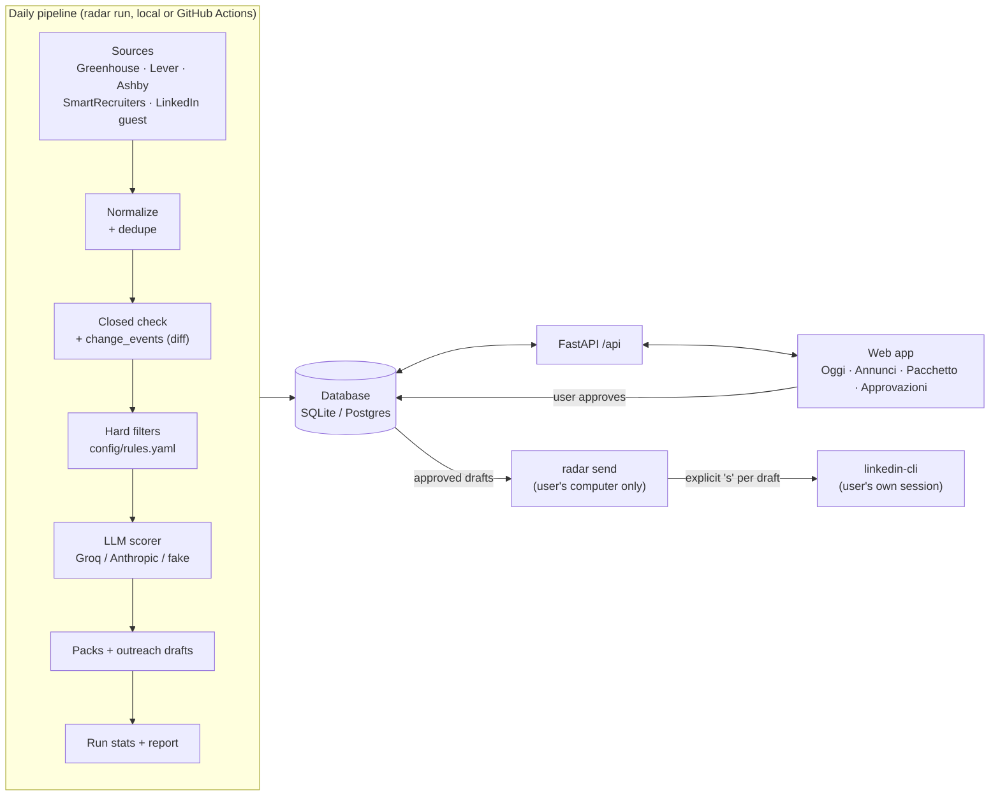

# Architecture

Radar is a small, single-user system: a Python package (`backend/radar`) with a CLI, a daily
pipeline and a FastAPI API, a React web app (`frontend/`), and one database (SQLite locally,
Postgres on Supabase later). The guiding rule is **human in the loop**: the machine collects,
filters, ranks and drafts; the user decides and acts.

## Data flow

## Components

| Component | Where | Role |
|---|---|---|
| Settings | `radar/config.py` | Env/.env settings; YAML config resolution: `config/<name>.yaml` -> DB `settings` row `config:<name>` -> `config/<name>.example.yaml` |
| Models / DB | `radar/models.py`, `radar/db.py` | SQLModel tables: companies, postings, change_events, runs, filter_results, scores, application_packs, contacts, drafts, applications, settings, llm_usage |
| Connectors | `radar/connectors/` | One module per source. Shared polite HTTP client (`http.py`): per-host rate limit, disk cache, honest user agent, robots.txt for HTML pages, back-off honouring `Retry-After` |
| Pipeline | `radar/pipeline/` | Normalization (company, location, country, zone), de-duplication (`dedupe_key`), closed detection, filters, diff |
| LLM | `radar/llm/` | Provider interface (Groq, Anthropic, offline `fake`), scoring, packs and drafts, style checks; token usage stored in `llm_usage` |
| API | `radar/api/` | JSON API used by the web app (contract in [API.md](API.md)); optional Supabase JWT auth with an allowed email |
| Web app | `frontend/` | Vite + React + TanStack Query. Daily view, postings, application pack, approvals, applications, settings |
| Sender | `radar/send.py` | `radar send`: interactive, local-only sending of approved LinkedIn drafts through linkedin-cli |
| CLI | `radar/cli.py` | `init-db`, `seed`, `demo`, `run`, `score`, `packs`, `refilter`, `add-url`, `serve`, `send`, `config push/pull` |

## Pipeline steps

1. **Collect**: each enabled connector fetches public postings for the companies in
   `config/companies.yaml` (by ATS slug) and the LinkedIn guest search queries. A failing source
   is recorded in the run stats and skipped; the run continues (`partial`).
2. **Normalize and dedupe**: canonical URL, `uid = <source>:<external_id>`, content hash, and a
   cross-source `dedupe_key` (normalized company + normalized title + country); duplicates point to the
   original via `duplicate_of`.
3. **Diff**: compare with the previous state and write `change_events` (`new`, `changed` with a
   field-level diff, `closed`, `reopened`). This powers the "since yesterday" view.
4. **Hard filters**: deterministic rules (`reject` or `flag`) with a human-readable reason and
   evidence; the user can override in the web app.
5. **Score**: postings that pass are scored by the LLM (priority Alta/Media/Bassa, why it fits,
   what does not, start window, language requirements, warnings). Scores are cached by content
   hash, so unchanged postings are not re-scored.
6. **Packs and drafts**: for the best postings, a cover letter, form answers and outreach drafts
   (connection note, message, follow-up) are generated with status `draft`.
7. **Report**: `runs` row with counts; a Markdown report in `data/reports/` (never printed in CI
   logs).

## Approval and sending

Drafts move `draft -> approved` only through the web app (a human click). Approved LinkedIn
drafts are sent only by `radar send`, on the user's computer, one at a time, after typing `s`
for each. `radar send` refuses to run when `CI` or `GITHUB_ACTIONS` is set and calls the
user's own `linkedin` CLI as a subprocess, so its throttle, daily quotas and session apply.
Results are written back (`sent` / `failed` + `send_result`). Applications on company sites are
always submitted by the user by hand; Radar only prepares the pack.

## Runs and daily diff

Every `radar run` creates a `runs` row (status, per-source counts, LLM usage) and links its
`change_events` to it. The web app's *Oggi* page reads the latest run, new and closed postings
since the previous run, upcoming deadlines, due follow-ups and pending approvals.
