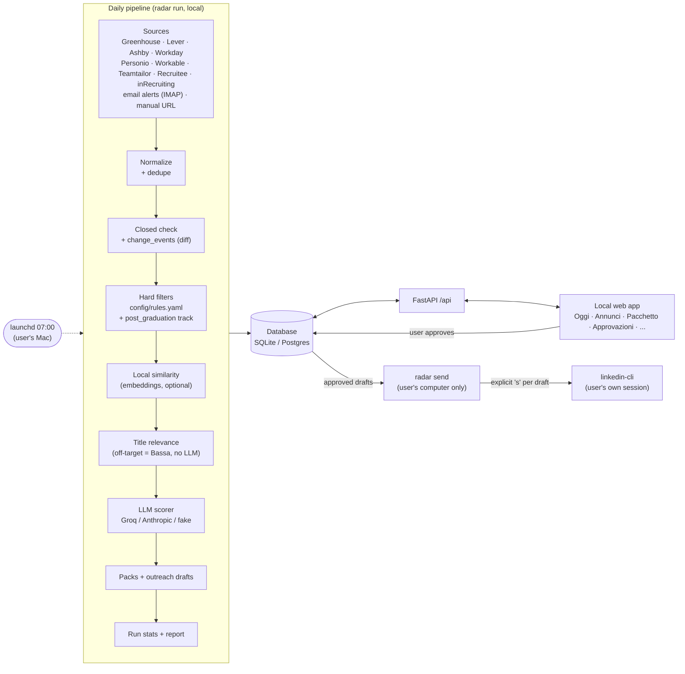

# Architecture

Radar is a small, single-user system: a Python package (`backend/radar`) with a CLI, a daily
pipeline and a FastAPI API, a React web app (`frontend/`), and one database (SQLite in
`data/radar.db` by default; Postgres optional, see [RUNNING.md](RUNNING.md#self-hosting-on-postgres-optional)).
Everything runs locally on the user's Mac; GitHub only hosts the code and runs CI. The guiding rule is **human in the loop**: the machine collects,
filters, ranks and drafts; the user decides and acts.

## Data flow

## Components

| Component | Where | Role |
|---|---|---|
| Settings | `radar/config.py` | Env/.env settings; YAML config resolution: `config/<name>.yaml` -> DB `settings` row `config:<name>` -> `config/<name>.example.yaml` |
| Models / DB | `radar/models.py`, `radar/db.py` | SQLModel tables: companies, postings, change_events, runs, filter_results, scores, application_packs, contacts, drafts, applications, settings, llm_usage |
| Connectors | `radar/connectors/` | One module per source: Greenhouse, Lever, Ashby, Workday, SmartRecruiters (disabled), LinkedIn guest (stands down on robots.txt), read-only IMAP email alerts (`email_alerts.py`, `email_parsers/`), JobTeaser offer pages through the user's own browser profile (`jobteaser.py`, Playwright, local Mac only; listing pages never opened) plus the "Salva in Radar" extension (`extension/jobteaser/` -> `POST /api/ingest/jobteaser`, `pipeline/jobteaser_ingest.py`). Shared polite HTTP client (`http.py`): per-host rate limit, disk cache, honest user agent, robots.txt checks, back-off honouring `Retry-After`. Details in [SOURCES.md](SOURCES.md) |
| Connectors | `radar/connectors/` | One module per source: Greenhouse, Lever, Ashby, Workday, SmartRecruiters (disabled), LinkedIn guest (stands down on robots.txt), the user's saved LinkedIn searches through linkedin-cli (`linkedin_jobs.py`, once a day, at most 25 calls), read-only IMAP email alerts (`email_alerts.py`, `email_parsers/`). Shared polite HTTP client (`http.py`): per-host rate limit, disk cache, honest user agent, robots.txt checks, back-off honouring `Retry-After`. Details in [SOURCES.md](SOURCES.md) |
| Connectors | `radar/connectors/` | One module per source: Greenhouse, Lever, Ashby, Workday, Personio, Workable, Teamtailor, Recruitee, inRecruiting, SmartRecruiters (disabled), LinkedIn guest (stands down on robots.txt), read-only IMAP email alerts (`email_alerts.py`, `email_parsers/`). Shared polite HTTP client (`http.py`): per-host rate limit, disk cache, honest user agent, robots.txt checks, back-off honouring `Retry-After`. Details in [SOURCES.md](SOURCES.md) |
| Pipeline | `radar/pipeline/` | Normalization (company, location, country, zone), de-duplication (`dedupe_key`), closed detection, filters (incl. the `post_graduation` track), diff, manual add by URL |
| LLM | `radar/llm/` | Provider interface (Groq, Anthropic, offline `fake`), deterministic title relevance (`relevance.py`), scoring, packs and drafts, style checks; token usage stored in `llm_usage` |
| Contact search | `radar/llm/contacts.py` | Public profiles for Alta postings via Groq browser search (server-side tool; Radar itself fetches no page and never logs in). Results are grounded in the executed searches, slug-checked, stored as "da verificare"; estimated cost per call in `llm_usage.est_cost_eur`, monthly EUR cap and daily call cap enforced before each call |
| Fact bank | `radar/facts.py` | Loads and flattens `config/facts.yaml` into `[id] text` facts and prohibitions (`use_in_drafts: false`, `not_stated`, `do_not_claim`, language levels); the only source of candidate facts for drafts |
| LLM | `radar/llm/` | Provider interface (Groq, Anthropic, offline `fake`), deterministic title relevance (`relevance.py`), scoring (from `config/profile.yaml`), packs and drafts (from the fact bank only), fact check (`verify.py`: deterministic pre-check + verifier call), style checks; token usage stored in `llm_usage` |
| API | `radar/api/` | JSON API used by the web app (contract in [API.md](API.md)); optional Supabase JWT auth with an allowed email (off by default, see [RUNNING.md](RUNNING.md#self-hosting-on-postgres-optional)) |
| Web app | `frontend/` | Vite + React + TanStack Query, Italian UI, local only. *Oggi*, *Annunci* (*Stage* \| *Dopo la laurea* \| *Scartati*, keyboard shortcuts), *Pacchetto*, *Approvazioni*, *Candidature*, *Aziende*, *Impostazioni*, *Esecuzioni*. axe-clean (WCAG 2.1 AA) at 1280 and 390 px |
| Sender | `radar/send.py` | `radar send`: interactive, local-only sending of approved LinkedIn drafts through linkedin-cli |
| CLI | `radar/cli.py` | `init-db`, `seed`, `demo`, `run`, `rank`, `score`, `packs`, `refilter`, `add-url`, `serve`, `send`, `db copy`, `db secure`, `config push/pull` |
| Scheduler | `scripts/schedule.sh`, `scripts/daily.sh` | macOS launchd job at 07:00 (`make schedule-install`); one run at a time, counts-only log in `logs/daily.log` |

## Pipeline steps

1. **Collect**: each enabled connector fetches public postings for the companies in
   `config/companies.yaml` (by ATS slug or Workday board), plus the optional email alerts (only
   LinkedIn and JobTeaser senders, read-only). A failing source is recorded in the run stats and
   skipped; the run continues (`partial`).
2. **Normalize and dedupe** (`pipeline/dedupe.py`): `uid = <source>:<external_id>`, content
   hash, a canonical URL key (tracking params, locales, `www.`, trailing slashes dropped; LinkedIn
   `/comm/jobs/view/<id>` and `?currentJobId=` links, JobTeaser offers on any career-center
   host, Greenhouse `gh_jid` pages collapse to one key per job) and a fuzzy key (company without
   legal suffixes/accents, title without gender markers, durations, seasons and places, country).
   The same job from the board, JobTeaser, LinkedIn and email alerts is ONE posting: every source
   keeps its own row, the others point at the primary via `duplicate_of`, and the primary lists
   all of them in `sources` (`{uid, source, url, via, external_id, first_seen, last_seen,
   listed}`). Fuzzy matches need the same company and country, compatible cities, title
   similarity >= 0.9 and different source families. The primary keeps its id when a better source
   arrives later (stable ids for packs, drafts, applications) but takes the best direct link
   (board > JobTeaser > LinkedIn > email) and a richer description. A job closes only when all
   its exhaustive sources (boards) stopped listing it. `radar dedupe backfill [--apply]` re-keys
   and merges an existing database (dry run by default, counts only, idempotent).
3. **Diff**: compare with the previous state and write `change_events` (`new`, `changed` with a
   field-level diff, `closed`, `reopened`). This powers the "since yesterday" view. Sources that
   list only some postings (email alerts) never close a posting by its absence.
4. **Hard filters**: deterministic rules in `config/rules.yaml` (`reject` or `flag`): start
   window (February 2027, flexible until April 2027), graduation year, PhD-only, 3+ years of
   experience, location (EU/EEA + Switzerland), UK visa, required languages, a flag for
   descriptions written mostly in French/German/Spanish/Dutch/Portuguese (local detector,
   `pipeline/langdetect.py`, no LLM), and a flag for French/Spanish enrollment-agreement
   requirements. Every hit stores the rule and the text that
   triggered it; the user can restore a posting with one click and undo it.
   The `post_graduation` flag marks graduate programmes and full-time roles that start after July
   2027 or after graduation. It is not an exclusion: those postings form a separate track, shown
   in *Dopo la laurea* (API `track` parameter).
5. **Rank** (optional `embed` extra): `pipeline/rank.py` embeds each open posting that passed
   the filters (title plus the start of the text) with a local multilingual sentence-transformers
   model and stores `postings.similarity` (0..1) against the profile: target roles from
   `profile.yaml` and the experience, projects and skills of `config/facts.yaml` (items with
   `use_in_drafts: false` skipped). Vectors are cached in `data/cache/embeddings.sqlite` by
   content hash; `similarity_version` changes with the model or the profile, which triggers a
   recompute. Without the extra this step is skipped with one log line.
6. **Score**: clearly off-target titles (tax, payroll, sales, legal, HR, ...) get a deterministic
   "Bassa" without an LLM call; the rest are scored by similarity (then title relevance), at
   most `--max-score` per run. The LLM returns priority
   Alta/Media/Bassa, why it fits, what does not, start window, language requirements and warnings.
   Every filter flag is passed to the scorer as a fact. Deterministic caps then apply
   (`llm/guards.py`): a required foreign language means Bassa at most, a description mostly in
   a foreign language Media at most, adjacent roles (generic software engineering, QA,
   fullstack, sales, BI/reporting) Media at most; each cap adds a warning.
   `radar rescore --flagged-language [--dry-run]` re-scores language-flagged postings scored
   before the caps.
   Scores are cached by content hash, so unchanged postings are not re-scored, and when the
   free-tier daily limit is hit the remaining postings are picked up by the next run.
7. **Packs and drafts**: for the best postings, a cover letter (at most 250 words, opening with
   the availability line, in English or Italian), form answers and outreach drafts (connection
   note, message, follow-up) are generated with status `draft`. Writing rules are checked in code
   (no em dashes, no cliches, length limits, `[CHECK: ...]` markers) and reported as
   `style_issues`.
8. **Report**: `runs` row with counts and LLM usage; a Markdown report in `data/reports/`, shown
   `style_issues`. Drafts may state only facts from the fact bank (`config/facts.yaml`); a
   second LLM call then maps every claim to a fact id (`supported` / `unsupported` / `check`),
   and a deterministic pre-check flags numbers not in the facts and prohibited mentions
   ("native" English, unlisted languages, GPA, excluded items). Results are stored as
   `verification` on the pack and its drafts; texts are never rewritten. `radar packs verify`
   and `radar packs regenerate` (before/after diffs under `data/packs_diff/`) re-run it.
7. **Report**: `runs` row with counts and LLM usage; a Markdown report in `data/reports/`, shown
   in *Esecuzioni* (never printed to the log).

## Approval and sending

Drafts move `draft -> approved` only through the web app (a human click). Approved LinkedIn
drafts are sent only by `radar send`, on the user's computer, one at a time, after typing `s`
for each. linkedin-cli v0.2 cannot attach a note to a connection request, so for those Radar
copies the note and opens the profile instead. `radar send` refuses to run when `CI` or `GITHUB_ACTIONS` is set and calls the
user's own `linkedin` CLI as a subprocess, so its throttle, daily quotas and session apply.
Results are written back (`sent` / `failed` + `send_result`). Applications on company sites are
always submitted by the user by hand; Radar only prepares the pack.

## Runs and daily diff

Every `radar run` creates a `runs` row (status, per-source counts, LLM usage) and links its
`change_events` to it. The web app's *Oggi* page reads the latest run, new and closed postings
since the previous run, upcoming deadlines, due follow-ups and pending approvals.
